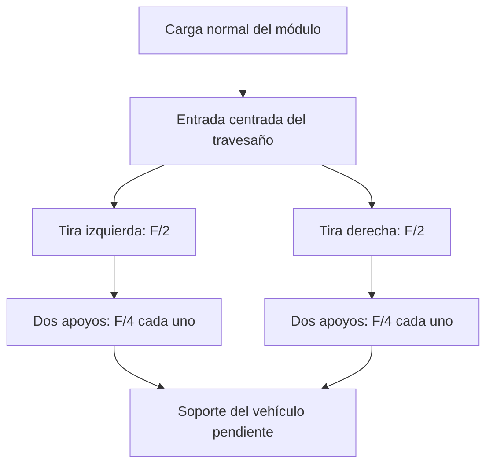

# IF-11 — camino de carga y contraplaca de estudio

Versión 0.10.0 · Investigación civil · NOT_RELEASED.

Propuesta: introducir la fuerza normal en el centro de un travesaño que reparte carga entre dos tiras de contraplaca, situadas en X=±35 mm. Cada tira se extiende en Y, con apoyos ideales en Y=±35 mm. La reacción pasa al soporte del vehículo. La conexión real entre cada apoyo, el perno y la estructura todavía debe detallarse; no es un ensamblaje listo para fabricar.



El centrado exige cambiar físicamente el punto de aplicación o proporcionar otra ruta de reacción del momento. Añadir un travesaño a una fuerza que sigue descentrada no elimina su momento. Los resultados centrados y descentrados de [0.9.0](IF11_ECCENTRIC.md) siguen vigentes: índice 0.771 al centro frente a 1.322 a X=25 mm en la peor esquina del barrido. No se afirma haber resuelto el descentramiento con una pieza todavía sin definir.

## Geometría y masa

Cada tira: 100 × 25 mm, dos taladros de 9 mm separados 70 mm. Espesores comparados: 6, 10 y 12 mm. Son piezas adicionales, no un cambio silencioso de la placa B. La masa de las dos tiras descuenta cuatro taladros y usa densidad nominal 2700 kg/m³. Excluye travesaño, soporte y herrajes. No se integra aún al presupuesto global porque falta cerrar la lista de piezas y la longitud de fijaciones.

## Aproximación de flexión

Se representa cada tira como viga simplemente apoyada de luz L=70 mm, sección rectangular uniforme b×t y carga puntual central P=F/2:

`I=bt³/12; Mmax=PL/4; σmax=Mmax(t/2)/I; δmax=PL³/(48EI)`.

Las cuatro reacciones suman F. Se usa E=68.3 GPa, valor típico de la [ficha Kaiser 6061, rev. 05/06](https://online.kaiseraluminum.com/depot/PublicProductInformation/Document/1015/Kaiser_Aluminum_6061_Sheet_Coil_and_Plate.pdf), página 1. Referencia de fórmulas elásticas: [AWC, Design Aid 6](https://web-media.awc.org/wp-content/uploads/2021/12/17210710/AWC-DA6-BeamFormulas-0710.pdf), viga simplemente apoyada con carga central; no se adoptan propiedades ni criterios de madera.

La sección uniforme ignora taladros en el cálculo resistente, que sólo se descuentan de la masa. Tampoco incluye apoyo bajo arandelas, contacto, precarga, flexibilidad de pernos, torsión, efecto de palanca ni deformación por cortante. La relación luz/espesor baja hasta 5.8: especialmente en la opción de 12 mm, la aproximación de viga esbelta necesita revisión. No es una cota conservadora garantizada.

Los resultados son demanda elástica nominal. Si hay plastificación, la tensión y flecha reales no siguen estas cifras. No se asigna un límite admisible ni se declara aprobación del material por comparación con valores típicos.

[Resultados numéricos](../evidence/IF-11/support/README.md): a 12 kN totales, la demanda nominal disminuye de 700 a 175 MPa entre 6 y 12 mm; la flecha de 1.395 a 0.174 mm y la masa de las tiras aumenta de 76.9 a 153.8 g. Es una comparación de hipótesis, no selección final.

## Próxima decisión

Conservar 10/12 mm como alternativas para estudiar contacto y apoyo local; la tira de 6 mm queda señalada por su elevada demanda nominal. Antes de refinar espesores: definir travesaño, asiento real de las tiras y ruta del momento. Contrastar entonces un modelo local con deformación por cortante/contacto o un ensayo instrumentado. La rigidez C del estudio de pernos no se actualiza automáticamente desde esta viga independiente.

G0/G1, carga combinada, fatiga y compatibilidad de montaje permanecen abiertos.

```sh
python3 software/if11_support.py
python3 -m unittest discover -s tests
```
